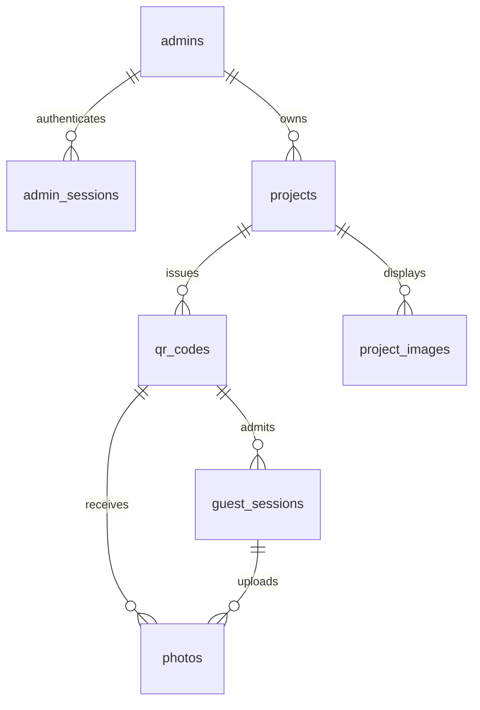

# Wedding Photo Booth — keputusan arsitektur

## Komponen

Modular monolith: React + TypeScript (Vite), REST API Express, SQLite (WAL,
foreign keys), dan filesystem privat. ASP.NET Core dipertimbangkan; Node dipilih
agar frontend, API, alat build, dan pengujian menggunakan satu runtime yang sudah
tersedia. Mode lokal memakai `node:sqlite` (experimental pada Node 22) pada satu
host dengan persistent volume. Mode Vercel memakai remote Turso/libSQL melalui
`@libsql/client/web` dan public Vercel Blob. Tidak ada fallback ke disk sementara
pada Vercel. `server/db.js` menyediakan operasi asinkron untuk kedua mode dan
meneruskan query helper ke transaksi yang sama melalui AsyncLocalStorage.

Frontend hanya mengelola tampilan, kamera, dan request; semua izin, kuota,
session, dan validasi file dimiliki API. Pada VPS, build frontend disajikan oleh
server API; pada Vercel oleh CDN, sedangkan API/media memakai satu Function.
Foto tidak disimpan sebagai Base64. Foto cloud mempunyai URL Blob publik sesuai
galeri acara; metadata internal dan credential hanya dapat diakses server.

## Relasi database

Skema berada di `server/schema.sql` dan `server/migrations.js`, dengan FK, indeks,
CHECK constraints, dan unique idempotency key per sesi. Settings acara tersimpan
di database. Foto yang dihapus memakai tombstone agar riwayat kuota tetap utuh.
Setiap foto memiliki pesan opsional maksimal 500 karakter, tersimpan sebagai teks
di `photos.message` dalam transaksi upload yang sama. Galeri dan pratinjau
menampilkannya sebagai teks di bawah foto, dengan baris baru dipertahankan dan
HTML di-escape oleh React. Foto lama mendapat pesan kosong melalui migration
idempoten `server/migrations.js`; jalankan `npm run db:init` sebelum deploy cloud.

Setiap QR terikat ke satu project dan setiap project memiliki pemilik. Foto dan transaksi pemakaian mewarisi project melalui QR. Pengaturan teks, tema, dan filter disimpan di project. Lima slot gambar memakai JPEG hasil crop. Perubahan teks dan gambar landing page disimpan dalam satu transaksi dengan pemeriksaan revisi.

Akun dengan peran `super` mengelola akun dan kuota. Peran `project` dibatasi oleh relasi pemilik pada API. Galeri dan media undangan memvalidasi username, kode, status QR, serta project foto. Rute publik lama menampilkan project bawaan. Admin dapat menonaktifkan akun studio untuk mencabut sesi dashboard dan akses undangannya.

## Alur QR dan kuota

1. Admin atau studio membuat QR pada project dengan kode khusus atau token acak 192 bit. Alokasi dibebankan pada pembuat QR. Server memeriksa saldo dan menyimpan perubahan dalam satu transaksi tulis. Admin dapat memilih total tanpa batas (NULL), dengan kuota per sesi tetap berlaku. URL mengikuti `/:username/:code`. Tautan lama `/camera/:code` tetap membuka kamera project terkait.
2. API memvalidasi QR dan membuat/melanjutkan cookie sesi HttpOnly 24 jam.
3. Kapasitas sesi = floor(total_limit / per_session_limit). Sisa pembagian
   ditampilkan sebagai kuota tidak teralokasi. Pembukaan sesi tidak memakai kuota
   foto, tetapi memesan satu slot. Sesi kedaluwarsa tanpa foto melepaskan slot;
   sesi dengan foto tetap dihitung untuk mencegah total kapasitas terlampaui.
4. Kamera mengirim multipart image dan pesan opsional dengan CSRF token serta idempotency key.
5. Browser mengompres foto di atas 3 MiB sebelum upload. API membatasi ukuran
   12 MiB lokal / 4 MiB Vercel, memeriksa MIME dan hasil decode Sharp, menolak
   animasi/format lain, merotasi EXIF lalu encode JPEG tanpa metadata (maks 4096px).
6. File dan thumbnail ditulis ke storage dengan nama UUID. `BEGIN IMMEDIATE`
   lokal / transaksi `write` libSQL mengunci writer pada database bersama;
   API mengecek ulang QR aktif, session ownership/expiry, batas sesi, dan total,
   lalu INSERT foto + UPDATE dua counter dalam satu transaksi asinkron.
7. Error database menghapus file baru dan rollback counter. Request ulang dengan
   key yang sama mengembalikan hasil terdahulu tanpa memakai kuota lagi.
8. Gallery membaca foto aktif terbaru dan melakukan polling ringan. Admin dapat
   melihat metadata, riwayat sesi, filter, dan menghapus foto. Penghapusan tidak
   mengembalikan kuota yang sudah digunakan.

Limit per sesi tidak dapat diubah setelah ada sesi. Total dapat diubah bila tetap
menampung seluruh slot yang sudah dialokasikan. Penghapusan QR dengan riwayat membuatnya nonaktif permanen. Perhitungan saldo akun mengganti alokasi QR tersebut dengan jumlah foto terpakai. Token cookie yang hilang dianggap
sesi baru; sistem anonim berbasis QR bukan verifikasi identitas orang.

## Keamanan dan operasional

Password scrypt + salt; session admin acak disimpan sebagai hash, expiry 12 jam,
cookie HttpOnly/SameSite=Strict/Secure di production. Semua mutasi memeriksa Origin
dan CSRF. Login, pembukaan sesi, dan upload dibatasi rate. Queries parameterized,
validasi Zod, Helmet CSP, error publik tanpa stack trace. Production memerlukan
HTTPS, PUBLIC_URL valid, persistent storage, dan backup database beserta files.
Mode cloud menyimpan penghitung rate limit di database agar konsisten lintas instance.
Tidak ada admin/password default maupun foto atau statistik contoh di database.

File dan database tidak memiliki transaksi bersama: file baru dibersihkan saat
rollback; startup lokal membersihkan orphan lebih tua dari satu jam. Jika respons
COMMIT remote hilang, objek dipertahankan karena transaksi mungkin berhasil;
retry dengan key yang sama merekonsiliasi hasil. Cold start Vercel tidak menghapus
Blob. Backup perlu
snapshot konsisten database dan storage (lihat README). Deployment/pengujian
perangkat fisik memerlukan domain HTTPS dan perangkat yang sebenarnya. Schema
cloud disiapkan secara eksplisit dengan `npm run db:init` sebelum deploy, dan
akun admin dibuat dengan `npm run admin:create`; keduanya tidak berjalan saat build.
Detail konfigurasi dan operasional cloud: [VERCEL.md](VERCEL.md).
